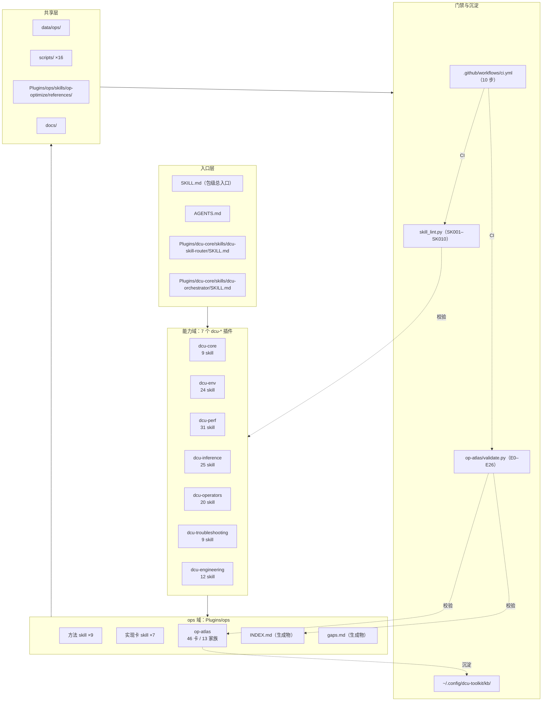
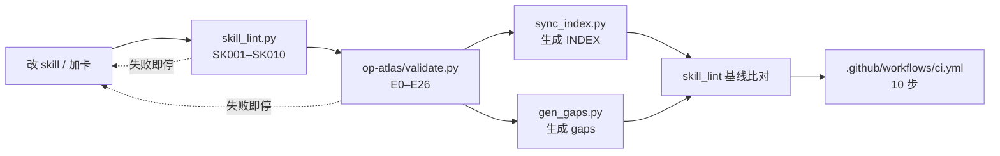
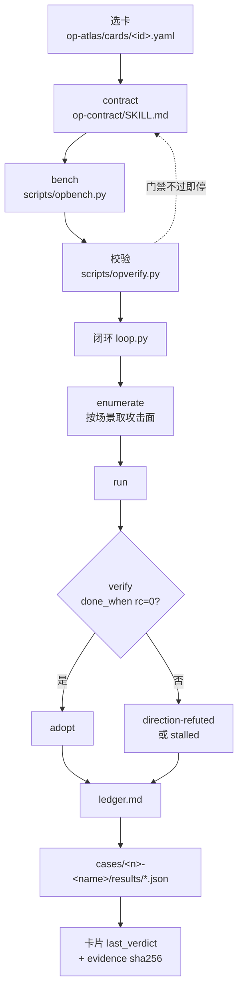
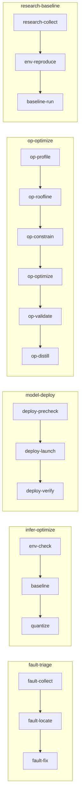

# 现状地图（map）

> **这是现状，不是设计。** 所有数字取自 2026-11-23 仓库实测，所有路径经 `test -e` 验证。
> 本文只回答「现在长什么样、跑起来经过哪些节点、哪里还漏着」。
> 设计意图见 [`ENGINE.md`](ENGINE.md) 与 [`OPS-CARD-DESIGN.md`](OPS-CARD-DESIGN.md)。

实测快照：**8 个插件 / 159 个 SKILL.md / 46 张 atlas 卡 / 13 个家族 / 门禁 E0–E26（E20 未使用）/ 5 个 workflow**。

---

## 一、分层

### 1.1 全景（mermaid）



### 1.2 同一张图的 ASCII 版

```
┌─ 入口层 ────────────────────────────────────────────────────────────┐
│  SKILL.md(包级) · AGENTS.md · dcu-skill-router · dcu-orchestrator    │
└──────────────────────────────┬──────────────────────────────────────┘
                               │ 意图路由
┌─ 能力域：7 个 dcu-* 插件 ─────▼──────────────────────────────────────┐
│  dcu-core 9 · dcu-env 24 · dcu-perf 31 · dcu-inference 25            │
│  dcu-operators 20 · dcu-troubleshooting 9 · dcu-engineering 12       │
└──────────────────────────────┬──────────────────────────────────────┘
                               │ 算子相关意图
┌─ ops 域 Plugins/ops ─────────▼──────────────────────────────────────┐
│  方法 skill ×9   实现卡 skill ×7                                     │
│  op-atlas: 46 卡 / 13 家族 / INDEX.md / gaps.md                     │
└──────────────────────────────┬──────────────────────────────────────┘
┌─ 共享层 ─────────────────────▼──────────────────────────────────────┐
│  data/ops/ · scripts/ ×16 · op-optimize/references/ · docs/         │
└──────────────────────────────┬──────────────────────────────────────┘
┌─ 门禁与沉淀 ─────────────────▼──────────────────────────────────────┐
│  skill_lint.py(SK001–010) · validate.py(E0–E26) · CI(10 步) · kb/   │
└─────────────────────────────────────────────────────────────────────┘
  实线=数据流    虚线=校验/门禁
```

### 1.3 各层文件清单（真实路径）

| 层 | 路径 | 实测数量 |
|---|---|---|
| 入口 | `SKILL.md` · `AGENTS.md` | 2 个文件 |
| 入口 | `Plugins/dcu-core/skills/dcu-skill-router/SKILL.md` | 全量路由索引 |
| 入口 | `Plugins/dcu-core/skills/dcu-orchestrator/SKILL.md` | 编排契约 |
| 能力域 | `Plugins/dcu-core/skills/` | 9 skill |
| 能力域 | `Plugins/dcu-env/skills/` | 24 skill |
| 能力域 | `Plugins/dcu-perf/skills/` | 31 skill |
| 能力域 | `Plugins/dcu-inference/skills/` | 25 skill |
| 能力域 | `Plugins/dcu-operators/skills/` | 20 skill |
| 能力域 | `Plugins/dcu-troubleshooting/skills/` | 9 skill |
| 能力域 | `Plugins/dcu-engineering/skills/` | 12 skill |
| ops | `Plugins/ops/skills/` | 16 skill（9 方法 + 7 实现卡） |
| ops | `Plugins/ops/op-atlas/cards/` | 46 卡 |
| ops | `Plugins/ops/op-atlas/families/` | 13 家族 |
| ops | `Plugins/ops/op-atlas/INDEX.md` | 生成物 |
| ops | `Plugins/ops/op-atlas/gaps.md` | 生成物 |
| 共享 | `data/ops/registry.json` | 7 条实现卡状态 |
| 共享 | `data/ops/libraries-registry.yaml` | 21 个库（20 canonical + 2 removed） |
| 共享 | `scripts/` | 16 个 .py |
| 共享 | `Plugins/ops/skills/op-optimize/references/` | surfaces（11）/ scenarios（6）/ failure-taxonomy / overlap-admissibility |
| 共享 | `docs/` | 6 个 .md |
| 门禁 | `skill_lint.py` | SK001–SK010 |
| 门禁 | `Plugins/ops/op-atlas/validate.py` | E0–E26（**E20 未使用，见 §四**） |
| 门禁 | `.github/workflows/ci.yml` | 10 步 |
| 沉淀 | `~/.config/dcu-toolkit/kb/op-opt/` | 用户态，不入库 |

### 1.4 ops 域细分

**方法 skill（9）**——回答「怎么做事」：
`op-bench` · `op-contract` · `op-gate` · `op-hip-compile` · `op-optimize` · `op-profiling` · `op-roofline` · `op-source-patch` · `op-stack-design`

**实现卡 skill（7）**——某个算子有几种实现、哪个档位用哪个：
`op-sparse-mla` · `op-moe-w8a8` · `op-gemm-fp8` · `op-moe-topk-gating` · `op-moe-align-permute` · `op-rmsnorm-fused` · `op-fused-add-rmsnorm`

> 实现卡 skill（7）与 atlas 卡（46）不是一回事：前者带 contract/bench/adapter，能真跑；
> 后者是索引级，多数只有映射与结论。

---

## 二、三条运行时序

### 2.1 结构治理：改一个 skill 到 CI 通过



| 步 | 命令 | 产物 |
|---|---|---|
| 1 | 改 `Plugins/<域>/skills/<skill>/SKILL.md` | — |
| 2 | `python3 skill_lint.py` | `lint-report.json`（与 `lint-baseline.json` 比，新增违规为 0） |
| 3 | `python3 Plugins/ops/op-atlas/validate.py` | 0 error（当前 14 warning，见 §四） |
| 4 | `python3 -I Plugins/ops/op-atlas/sync_index.py` | `INDEX.md` |
| 5 | `python3 -I scripts/gen_gaps.py` | `gaps.md` + `.gaps-state.json` |
| 6 | `python3 -I scripts/gen_gaps.py --check` | 同步断言 |
| 7 | `.github/workflows/ci.yml` | 10 步全绿 |

CI 的 10 步（实测顺序）：`sanitize selftest` → `sanitize scan` → `static evals` → `op-atlas validate` → `eval_rate/geomean/aggregate 自检` → `鲁棒性门自检（注入缺陷必须抓到）` → `gaps.md 同步` → `INDEX 同步` → `ops tests` → `structure lint`。

### 2.2 算子优化：从选卡到结论落盘



| 步 | 命令 / 文件 | 产物 |
|---|---|---|
| 1 | 读 `Plugins/ops/op-atlas/cards/<id>.yaml` | 该卡的 impls / ceiling / 上次结论 |
| 2 | 按 `Plugins/ops/skills/op-contract/SKILL.md` 写 `contract.yaml` | 判据与容差 |
| 3 | `python3 -I scripts/opbench.py` | median / MAD / clock_mhz / ts |
| 4 | `python3 -I scripts/opverify.py` | 四道门（身份/正确性/不变量/A-B） |
| 5 | `python3 -I Plugins/ops/skills/op-optimize/loop.py -C <卡> enumerate --scenario <s>` | 攻击面清单 |
| 6 | `loop.py run` | `runs/loop/*.jsonl` |
| 7 | `loop.py verify --tag <id>` | 跑 `done_when`，rc=0 才 adopted |
| 8 | `loop.py direction-refuted` / `loop.py stalled` | refuted 计方向预算；stalled 不计、可作父代 |
| 9 | `<卡>/ledger.md` | 证据叙述 |
| 10 | `Plugins/ops/skills/op-optimize/cases/<n>-<name>/results/*.json` | 可复跑证据 |
| 11 | 卡片 `last_verdict.evidence` | sha256 指纹，E25 校验 |

### 2.3 编排：5 个 workflow 的主链



| workflow | 节点序列 | 文件 |
|---|---|---|
| `fault-triage` | fault-collect → fault-locate → fault-fix | `Plugins/dcu-core/skills/dcu-orchestrator/workflows/fault-triage.yaml` |
| `infer-optimize` | env-check → baseline → quantize | `.../workflows/infer-optimize.yaml` |
| `model-deploy` | deploy-precheck → deploy-launch → deploy-verify | `.../workflows/model-deploy.yaml` |
| `op-optimize` | op-profile → op-roofline → op-constrain → op-optimize → op-validate → op-distill（6 节点） | `.../workflows/op-optimize.yaml` |
| `research-baseline` | research-collect → env-reproduce → baseline-run | `.../workflows/research-baseline.yaml` |

ASCII 版：

```
fault-triage      : fault-collect → fault-locate → fault-fix
infer-optimize    : env-check → baseline → quantize
model-deploy      : deploy-precheck → deploy-launch → deploy-verify
op-optimize       : op-profile → op-roofline → op-constrain → op-optimize → op-validate → op-distill
research-baseline : research-collect → env-reproduce → baseline-run
```

---

## 三、节点状态（verified / unverified）

「verified」= 本机能跑且有实测证据；「unverified」= 存在但缺证据。

| 节点 | 状态 | 缺什么 |
|---|---|---|
| `skill_lint.py` | **verified** | — |
| `op-atlas/validate.py` | **verified** | — |
| `sync_index.py` | **verified** | — |
| `gen_gaps.py` | **verified** | — |
| `scripts/opbench.py` | **verified** | — |
| `scripts/evalrate.py` | **verified** | — |
| `scripts/geomean.py` | **verified** | — |
| `scripts/aggregate.py` | **verified** | 只覆盖 10 张有证据的卡 |
| `scripts/opverify.py` | **verified** | — |
| `scripts/opcheck.py`（含 robustness） | **verified** | 只有 1 张卡真跑过 robustness |
| `op-optimize/loop.py` | **verified** | 12 个子命令，只有 3 张卡用过 |
| `case 001–010` | **verified** | 10 个 case 全部有 results |
| `op-profiling` 的 PMC 采集 | **unverified** | **只有知识卡（`references/pmc_reference.py.md`），没有采集器** |
| 5 个 workflow | **unverified** | YAML 结构在，但没有一次端到端跑通的记录 |
| 13 个家族的 failure-modes | **unverified** | 只有 `Plugins/ops/skills/op-moe-w8a8/references/failure-modes.yaml` 一份 |
| 14 张 measured 卡的 evidence | **unverified** | 见 §四 |

---

## 四、已知缺口（这张图必须包含的部分）

| 缺口 | 实测 | 影响 |
|---|---|---|
| **E20 从未使用** | `grep -c '"E20"' validate.py` = 0 | 编号跳号；E19 与 E21 之间是空的 |
| **14 张 measured 卡缺 evidence** | E25 报 14 warning | 按裁决不进聚合；连续 2 批仍缺则降级 draft |
| **5 个家族零实测** | `kv`(3) / `linear-attn`(6) / `memory`(1) / `quant`(2) / `sampling`(3) 全 draft | 46 卡里这 15 张没有任何实测结论 |
| **真实加速只有 2 张** | 排除缺证据卡后，>1.2× 的只有 `mlp-swiglu` 2.26× / `moe-pipeline-fusion` 1.69× | 推进层薄弱 |
| **7 个家族里 3 个无 speedup 数据** | `elementwise` / `gemm` / `rope` 只有 util 或 throughput | 无法参与排序 |
| **只有 1 份 failure-modes** | `find Plugins/ops -name failure-modes.yaml` = 1 | 46 张卡里 45 张没有「别这么干」的护栏 |
| **PMC 无采集器** | `op-profiling/` 只有 SKILL.md + 2 个 references | 0.03 这类值只知差多少，不知为什么差 |
| **`ratio_other` 3 条** | E24b 上限 5，当前 3 | 接近上限说明分类还需收敛 |

---

## 五、图例

- **实线** = 数据流（上一步的产物是下一步的输入）
- **虚线** = 校验 / 门禁（不通过就停）
- **红色** = 当前失败或缺口（本图的 mermaid 未使用红色，缺口见 §四表）
- 节点旁的 `verified` / `unverified` 见 §三

---

*采集时间：2026-11-23。所有路径经 `test -e` 验证存在；所有数字经命令实测，无估算。*
